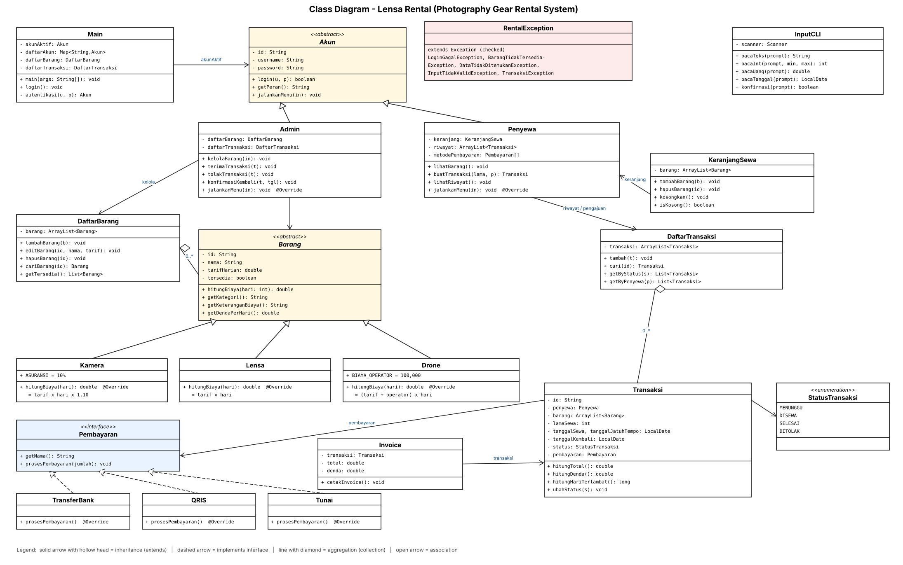

# Lensa Rental - Photography Gear Rental System (Java CLI)



## Description
A command line rental system written in Java for the final project (UAS) of
*Praktikum Pemrograman Berorientasi Objek (PBO) - Class B*.
The shop rents **photography equipment**: cameras, lenses and drones.
It uses the main OOP concepts: abstraction, inheritance, polymorphism,
encapsulation, interface, collections (`ArrayList`, `HashMap`) and custom exceptions.
### Features
**Admin**
- Add, edit and delete rental items
- See and accept (or reject) rental transactions
- Confirm item return and calculate the late fee (per day of delay)
**Renter**
- See the list of available items
- Put one or more items in the rental list
- Make a transaction with a rental duration (days) and choose a payment method
- See rental history (after the admin accepted the transaction) and print invoices
Items that are being rented cannot be rented by other renters.
### Item categories (different cost calculation)
| Category | Cost formula |
|----------|--------------|
| Camera   | daily rate x days + 10% insurance |
| Lens     | daily rate x days |
| Drone    | (daily rate + Rp 100,000 operator fee) x days |
Late fee = days late x 50% of the daily rate of every rented item.
### Payment methods
Bank Transfer, QRIS, Cash (all implement the `Pembayaran` interface).
## Demo accounts
| Role   | Username | Password    |
|--------|----------|-------------|
| Admin  | admin    | admin123    |
| Renter | penyewa  | penyewa123  |
## How to run
Requires JDK 8 or newer.
```
javac -d out src/*.java
java -cp out Main
```
## Class structure
See `ClassDiagram.png`. Main classes: `Main`, `Akun` (abstract) -> `Admin`, `Penyewa`;
`Barang` (abstract) -> `Kamera`, `Lensa`, `Drone`; `DaftarBarang`, `KeranjangSewa`,
`DaftarTransaksi`, `Transaksi`, `Invoice`; interface `Pembayaran` -> `TransferBank`, `QRIS`, `Tunai`.
## Members
1. Zaw Thein Htet - 250810701100118
2. [Member 2 name - NIM]
3. [Member 3 name - NIM]
